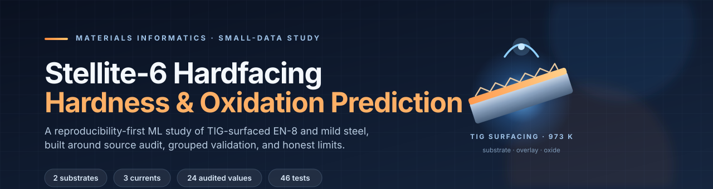
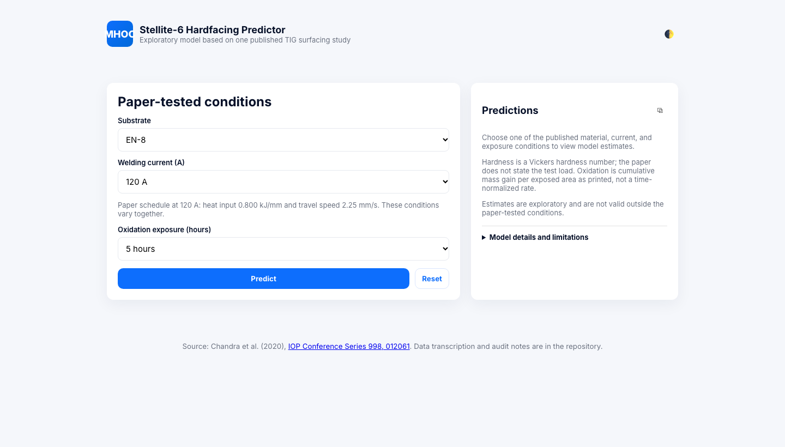
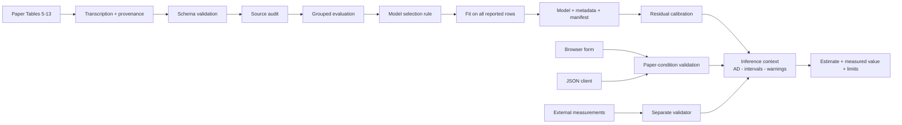
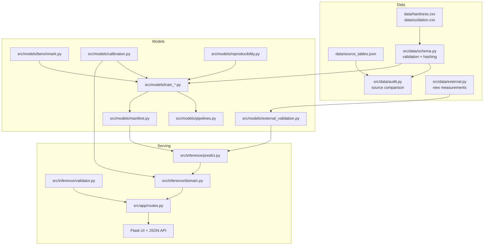

<p align="center">
  
</p>

<h1 align="center">Stellite-6 Hardness &amp; Oxidation Prediction</h1>

<p align="center">
  <strong>A paper-grounded, reproducibility-first machine-learning study of TIG-hardfaced ferrous alloys.</strong>
</p>

<p align="center">
  <a href="https://material-hardness-oxidation-prediction.onrender.com/"></a>
  <a href="https://github.com/TheComputationalCore/Material-Hardness-Oxidation-Prediction/actions/workflows/ci.yml"></a>
  
  
  
  
  
</p>

<p align="center">
  <a href="https://doi.org/10.1088/1757-899X/998/1/012061"></a>
  <a href="LICENSE"></a>
  <a href="data/LICENSE"></a>
</p>

<p align="center">
  <a href="https://material-hardness-oxidation-prediction.onrender.com/"><strong>Live application</strong></a>
  &nbsp;·&nbsp;
  <a href="https://doi.org/10.1088/1757-899X/998/1/012061">Source paper</a>
  &nbsp;·&nbsp;
  <a href="docs/SOURCE_AUDIT.md">Source audit</a>
  &nbsp;·&nbsp;
  <a href="docs/MODEL_CARD.md">Model card</a>
  &nbsp;·&nbsp;
  <a href="docs/REPRODUCIBILITY.md">Reproducibility</a>
  &nbsp;·&nbsp;
  <a href="docs/API_REFERENCE.md">API reference</a>
</p>

> **Research scope.** This repository reproduces and explores the measurements in one published experiment. It is not an independently validated engineering predictor. The paper reports six hardness values and eighteen oxidation values with no replicate specimens or uncertainty estimates. The eighteen oxidation rows reduce to six effective Material × Current conditions.

---

## Contents

- [At a glance](#at-a-glance)
- [Why this project is different](#why-this-project-is-different)
- [Scientific question](#scientific-question)
- [Source and experimental scope](#source-and-experimental-scope)
- [Data and provenance](#data-and-provenance)
- [Source audit](#source-audit)
- [Methodology](#methodology)
- [Results](#results)
- [Uncertainty and applicability](#uncertainty-and-applicability)
- [Application and API](#application-and-api)
- [Architecture and repository layout](#architecture-and-repository-layout)
- [Reproduce the study](#reproduce-the-study)
- [Testing and CI](#testing-and-ci)
- [Deployment](#deployment)
- [External measurements](#external-measurements)
- [Research roadmap](#research-roadmap)
- [Limitations and responsible use](#limitations-and-responsible-use)
- [Citation, license, and acknowledgements](#citation-license-and-acknowledgements)
- [Archived material](#archived-material)

---

## At a glance

| | |
|---|---|
| **Study** | Stellite-6 hardfacing deposited on EN-8 and mild steel by TIG surfacing |
| **Source** | Chandra et al., *IOP Conference Series: Materials Science and Engineering* 998 (2020) 012061 |
| **Targets** | Vickers hardness; cumulative areal mass gain after 5–15 h at 973 K (700 °C) |
| **Process conditions** | 2 substrates × 3 welding currents (120, 140, 160 A) |
| **Training data** | 6 hardness values; 18 oxidation values from 6 effective Material × Current cells |
| **Models** | Linear hardness model (v0.2.0); linear oxidation-rate model (v0.3.0) |
| **Validation** | Leave-one-current-out (primary); leave-one-condition-out (secondary) |
| **Audit** | 24 / 24 values and source-table labels match; unit, sign, and area remain unresolved |
| **Uncertainty** | Approximate 90 % empirical intervals plus an applicability domain |
| **Quality gates** | 46 tests, Ruff, source audit, training, calibration, reproducibility, benchmark, external validation |
| **Delivery** | Flask browser interface and JSON API on Render, with `/healthz` |

### Headline results

| Target | Validation | MAE | RMSE | R² | Honest reading |
|---|---|---:|---:|---:|---|
| Hardness | Leave-one-current-out | 26.25 HV | 27.51 HV | −0.656 | Withholding a current is worse than predicting the mean; the model is a transparent baseline, not a validated hardness predictor. |
| Oxidation | Leave-one-current-out | 1.346 × 10⁻⁴ (g/mm² as printed) | 1.631 × 10⁻⁴ | 0.9936 | Strong on six effective conditions, but not evidence of eighteen independent kinetic observations. |

<p align="center">
  
</p>

<p align="center"><em>Current interface, captured from the deployed application. The form only exposes paper-tested conditions; estimates are accompanied by measured values, applicability, and warnings.</em></p>

---

## Why this project is different

Most small-data materials ML demos stop at a fitted curve. This one treats the **evidence chain** as the deliverable:

- **Audit before modelling.** Every CSV value and source-table label is compared with the paper. Arithmetic, exposure-time multiples, specimen dimensions, units, and sign conventions are checked and documented.
- **Grouped validation.** An entire welding current is held out at a time, so the score measures transfer to an unseen process setting rather than interpolation inside the table.
- **Pre-registered model selection.** Challengers must beat the shipped model by at least 20 % in primary MAE, improve at least two of three folds, and not degrade the secondary protocol by more than 10 %.
- **Reproducibility as a CI gate.** Dataset hashes, model hashes, environment details, metrics, and limitations are recorded in manifests. CI retrains, recalibrates, recomputes the benchmark, and fails on unexplained drift.
- **Uncertainty with a stated basis.** Intervals come from signed out-of-fold residuals. They are labelled approximate because six conditions cannot support guaranteed coverage.
- **External data without leakage.** New measurements enter through a separate validated path and are never merged into training automatically. Oxidation residuals require a comparable paper-unit value, so the unresolved unit cannot hide inside an apparently precise metric.
- **Limits in the product.** The API, UI, model metadata, model card, and manifests all repeat the same scientific caveats.

---

## Scientific question

Stellite-6 is a cobalt-based hardfacing alloy used to resist wear and oxidation. The source study deposits a single 1 mm layer on EN-8 and mild steel, then measures:

1. **Vickers hardness** of the hardfaced surface.
2. **Mass change after isothermal exposure** at 973 K for 5, 10, and 15 hours.

The modelling question is not “can a flexible model fit 24 table values?” It is:

> What can be learned, and honestly claimed, from two substrates, three process settings, and no replicate specimens?

The answer shapes the entire repository: simple estimable models, grouped validation, approximate intervals, explicit applicability, and documentation of what the source does not support.

---

## Source and experimental scope

> C. Dinesh Chandra, B. Rushikesh, Mohammed Numan, and B. Venkatesh,
> “Experimental Studies of Stellite-6 Hardfaced Layer on Ferrous Materials by TIG
> Surfacing Process,” *IOP Conference Series: Materials Science and Engineering*,
> vol. 998 (2020), 012061.
> [https://doi.org/10.1088/1757-899X/998/1/012061](https://doi.org/10.1088/1757-899X/998/1/012061)

The paper is licensed CC BY 3.0. Two PDF copies were compared during the audit: an author-supplied copy and the open-access IOP copy. All tabulated values and both oxidation equations agree between them.

### Reported process schedule

| Parameter | Reported values | Role in the dataset |
|---|---|---|
| Substrate | EN-8; Mild Steel | Model input |
| Welding current | 120, 140, 160 A | Model input and validation group |
| Arc voltage | 15 V | Process metadata |
| Travel speed | 2.25, 2.43, 2.63 mm/s | Process metadata; changes with current |
| Heat input | 0.800, 0.864, 0.912 kJ/mm | Metadata; reproduced by `Q = V · I / v` |
| Filler | Stellite-6 rod, 3.2 mm diameter | Constant across the study |
| Deposit | One 1 mm layer on 60 × 30 × 6 mm plates; oil quenched | Process context |
| Oxidation exposure | 5, 10, 15 h at 973 K (700 °C) | Oxidation input |
| Oxidation area | 225 mm² in Table 7; methods imply 900 mm² | Unresolved; see audit |

> **Collinearity warning.** Current, travel speed, and heat input change together as a one-dimensional schedule. The coefficient on current is therefore an index of the process setting, **not** a causal current effect. No model in this repository separates their influences.

### Paper-tested prediction conditions

| Input | Allowed values | Notes |
|---|---|---|
| `Material` | `EN-8`, `Mild Steel` | Two substrates |
| `Current` | `120`, `140`, `160` A | Three process settings |
| `Exposure_Time_h` | `5`, `10`, `15` h | Oxidation only |

The service rejects unsupported levels rather than extrapolating. The Vickers test load, indentation count, indentation locations, furnace atmosphere, heating/cooling rates, and replicate structure are not reported.

---

## Data and provenance

| File | Rows | Content |
|---|---:|---|
| [`data/hardness.csv`](data/hardness.csv) | 6 | One Vickers hardness value per Material × Current condition (Tables 5–6) |
| [`data/oxidation.csv`](data/oxidation.csv) | 18 | Cumulative areal mass gain per Material × Current × Exposure (Tables 8–13) |
| [`data/source_tables.json`](data/source_tables.json) | — | Transcribed source values, equations, units, specimen statements, and PDF digests |
| [`data/README.md`](data/README.md) | — | Column meanings, units, scope, and unresolved issues |
| [`data/external/`](data/external/README.md) | — | Header-only templates and validator for new measurements |
| [`data/LICENSE`](data/LICENSE) | — | CC BY 3.0 notice for the transcribed paper data |

Every training row is marked `reported_paper_measurement` and carries a stable `Row_ID`, `Source`, `Source_Table`, `Observation_Group`, `Specimen_ID`, `Derivation_Status`, `Replicate_Status`, and `Chemistry_Status`. The training loader rejects any other `Data_Status`; new measurements cannot leak into the training set.

The dataset is canonical and hashed:

| File | SHA-256 |
|---|---|
| `data/hardness.csv` | `1d83be25aa4b59453bc24b816c7f6267be0e0b7480bc8fc2a394fba9d6745a60` |
| `data/oxidation.csv` | `be5edafcebde4ada00ba3578df623b84953f79ed030f109f20cfdf9ade6f820b` |
| `data/source_tables.json` | `a444175f2ed578396b6a1d1a25de6cfd6553e4b45fcb799a9e0d1aeda8953bb0` |

> **No fabricated rows.** Interpolated, smoothed, or inferred values are not independent experiments and are never treated as training measurements.

---

## Source audit

The audit is a CI gate. Human-readable findings are in [`docs/SOURCE_AUDIT.md`](docs/SOURCE_AUDIT.md); machine-readable output is in [`reports/audit/`](reports/audit/).

| Check | Status | Finding |
|---|---|---|
| Table transcription | **Pass** | 24 / 24 values and source-table labels match the paper |
| Process arithmetic | **Pass** | `Q = 15 V · I / v` reproduces 0.800, 0.864, and 0.912 kJ/mm within 5.5 × 10⁻⁴ kJ/mm |
| Exposure-time multiples | **Warning** | 11 exact and 1 near multiple of the 5 h value; the 18 rows contain 6 effective conditions |
| Specimen dimensions | **Unresolved** | Methods say 30 × 30 mm²; Table 7 says 15 × 15 mm with 225 mm² exposed area |
| Oxidation unit | **Unresolved** | Literal g/mm² implies 0.487–1.817 g specimen change, which is not plausible |
| Oxidation sign | **Unresolved** | Printed `w1 − w2` implies mass loss, but every tabulated value is positive |
| Replication | **Warning** | No replicate specimens, repeated indentations, or repeated weighings are reported |

### What the unresolved issues mean

**Unit.** If the tabulated numbers are read literally as g/mm² over 225 mm², the implied mass change is 4.6–17.1 % of a roughly 10.6 g specimen, which is not credible for 5–15 h at 700 °C. If the numbers are raw grams, the implied areal gain is 0.96–3.59 mg/cm² at 225 mm² or 0.24–0.90 mg/cm² at 900 mm². Both are physically plausible. The raw weights and measured area are not published, so no conversion is applied.

**Sign.** For an oxidation test the specimen normally gains mass, making `w1 − w2` negative. Every printed value is positive. Either the equation is transposed or the specimens lost mass. No sign correction is applied.

**Area.** The methods and Table 7 disagree by a factor of four. The project uses the Table 7 area because it accompanies the oxidation tables, but records the conflict rather than choosing silently.

**Independence.** Eleven of the twelve 10 h and 15 h values are exact multiples of the 5 h value to printed precision, and the twelfth differs by 0.08 %. The paper's statement that three samples were kept in the furnace per run is consistent with one specimen per current, not triplicate specimens. Every manifest therefore records `effective_independent_observations = 6`.

> **What we do not do:** assume the intended unit, flip the sign, invent replicates, or rescale values to make the figures look physically neat. The issues are surfaced in the data columns, API warnings, UI, manifests, model card, and benchmark notes.

Open questions for the authors are listed in [`docs/SOURCE_AUDIT.md`](docs/SOURCE_AUDIT.md#8a-questions-for-the-authors).

---

## Methodology

### End-to-end pipeline



### Features and models

| Target | Features | Model | Version |
|---|---|---|---|
| Hardness | One-hot substrate; standardized current | Ordinary least squares | v0.2.0 |
| Oxidation | One-hot substrate; standardized current; exposure hours | Linear rate model | v0.3.0 |

```text
Hardness = β0 + β1 · Current + β2 · [Material = Mild Steel] + ε

rate = a + b · Current + c · [Material = Mild Steel]
Areal_Mass_Gain = rate × Exposure_Time_h
```

The oxidation model fits areal gain per hour and multiplies by exposure. This follows the table's near-exact linear-time structure and avoids asking a tree ensemble to extrapolate with six effective conditions. The hardness model remains the simplest estimable model because no challenger met the adoption rule.

### Validation protocols

| Protocol | Group held out | What it tests | Use |
|---|---|---|---|
| `LOCO_current` | All rows at one welding current | Transfer to an unseen process setting | Primary |
| `LOGO_condition` | One Material × Current cell | Interpolation between conditions | Secondary |

Both protocols use the same rows and folds for every model. Two of the three LOCO folds require prediction outside the training current range; this is deliberately a stress test.

### Pre-registered model-selection rule

A challenger may replace the shipped model only if it satisfies all three conditions:

1. Primary LOCO MAE improves by at least **20 %**.
2. At least **two of three** LOCO folds improve.
3. Secondary LOGO MAE does not worsen by more than **10 %**.

| Target | Shipped model | Best challenger | Δ LOCO MAE | Folds improved | Decision |
|---|---|---|---:|---:|---|
| Hardness | `linear` | `ridge` | −12.0 % | 1 / 3 | Keep `linear` |
| Oxidation | `random_forest` (v0.2.0) | `rate_linear` | −69.4 % | 3 / 3 | Adopt `rate_linear` |

The oxidation change also reduced secondary LOGO MAE by 47.2 %. The full OOF predictions, fold metrics, selection record, and single-row sensitivity are in [`reports/benchmark/`](reports/benchmark/).

### Leakage controls

- Grouped folds by current, never random row splits.
- All rows at the held-out current, including both substrates and all exposure times, are removed from training.
- Features are limited to substrate and current; heat input, speed, carbon, and manganese are metadata because they are collinear or tied to substrate identity.
- Model selection uses the same folds and a rule fixed before the results are inspected.
- External rows are validated and scored separately; they are not merged into training.

---

## Results

### Primary validation metrics

| Target | Protocol | MAE | RMSE | R² | Fold MAE (mean ± sd) |
|---|---|---:|---:|---:|---:|
| Hardness | `LOCO_current` | 26.25 HV | 27.51 HV | −0.656 | 26.25 ± 7.42 |
| Oxidation | `LOCO_current` | 1.346 × 10⁻⁴ | 1.631 × 10⁻⁴ | 0.9936 | 1.35 × 10⁻⁴ ± 0.48 × 10⁻⁴ |

The metrics come from out-of-fold predictions. The deployable pipelines are refit on all reported rows **after** validation, so these numbers describe transfer to an unseen current, not training residuals.

### Hardness out-of-fold predictions

| Material | Current (A) | Observed (HV) | Predicted (HV) | Residual |
|---|---:|---:|---:|---:|
| EN-8 | 120 | 331 | 357.50 | +26.50 |
| Mild Steel | 120 | 310 | 346.50 | +36.50 |
| EN-8 | 140 | 365 | 351.00 | −14.00 |
| Mild Steel | 140 | 353 | 335.50 | −17.50 |
| EN-8 | 160 | 371 | 405.75 | +34.75 |
| Mild Steel | 160 | 361 | 389.25 | +28.25 |

<details>
<summary><strong>Oxidation out-of-fold predictions (18 rows)</strong></summary>

| Material | Current (A) | Exposure (h) | Observed | Predicted | Residual |
|---|---:|---:|---:|---:|---:|
| EN-8 | 120 | 5 | 0.002603 | 0.002586 | −0.000017 |
| Mild Steel | 120 | 5 | 0.002692 | 0.002765 | +0.000073 |
| EN-8 | 120 | 10 | 0.005206 | 0.005172 | −0.000034 |
| Mild Steel | 120 | 10 | 0.005384 | 0.005529 | +0.000145 |
| EN-8 | 120 | 15 | 0.007809 | 0.007758 | −0.000051 |
| Mild Steel | 120 | 15 | 0.008076 | 0.008294 | +0.000218 |
| EN-8 | 140 | 5 | 0.002296 | 0.002383 | +0.000087 |
| Mild Steel | 140 | 5 | 0.002580 | 0.002464 | −0.000116 |
| EN-8 | 140 | 10 | 0.004592 | 0.004766 | +0.000174 |
| Mild Steel | 140 | 10 | 0.005156 | 0.004929 | −0.000227 |
| EN-8 | 140 | 15 | 0.006888 | 0.007149 | +0.000261 |
| Mild Steel | 140 | 15 | 0.007740 | 0.007393 | −0.000347 |
| EN-8 | 160 | 5 | 0.002163 | 0.002135 | −0.000028 |
| Mild Steel | 160 | 5 | 0.002237 | 0.002321 | +0.000084 |
| EN-8 | 160 | 10 | 0.004326 | 0.004269 | −0.000057 |
| Mild Steel | 160 | 10 | 0.004474 | 0.004642 | +0.000168 |
| EN-8 | 160 | 15 | 0.006489 | 0.006404 | −0.000085 |
| Mild Steel | 160 | 15 | 0.006711 | 0.006963 | +0.000252 |

Residual = predicted − observed, in the paper's printed units. The 10 h and 15 h rows are exact or near-exact multiples of the 5 h values, so the 18 residuals are not 18 independent tests.

</details>

### Benchmark against simple baselines

Every baseline and challenger was run under identical folds:

| Target | Protocol | Best model | MAE | R² |
|---|---|---|---:|---:|
| Hardness | `LOCO_current` | `ridge` | 23.10 | −0.329 |
| Hardness | `LOGO_condition` | `random_forest` | 10.77 | 0.539 |
| Oxidation | `LOCO_current` | `rate_linear` (shipped) | 1.346 × 10⁻⁴ | 0.9936 |
| Oxidation | `LOGO_condition` | `rate_linear` (shipped) | 1.749 × 10⁻⁴ | 0.9910 |

The hardness ridge model improves LOCO MAE but fails the fold and secondary-protocol requirements, so the simpler linear model remains. The oxidation rate model is best under both protocols. Full tables, including global means, substrate means, time means, and random forests, are in [`reports/benchmark/summary.md`](reports/benchmark/summary.md).

### Why the hardness R² is negative

With six conditions, holding out an entire current leaves four training rows spanning only two currents. The linear model must extrapolate to the unseen current, and its errors are larger than the variance around the mean of the held-out rows. That is an honest result, not a bug: the data do not support reliable hardness transfer across currents.

---

## Uncertainty and applicability

Every API response includes an approximate 90 % interval from signed leave-one-current-out residual quantiles:

| Target | OOF predictions | Effective n | Lower offset | Upper offset | Source |
|---|---:|---:|---:|---:|---|
| Hardness | 6 | 6 | −17.50 HV | +36.50 HV | `models/calibration.json` |
| Oxidation | 18 | 6 | −3.465 × 10⁻⁴ | +2.61 × 10⁻⁴ | `models/calibration.json` |

The offsets are asymmetric because the residuals are skewed. They are **empirical, approximate intervals**, not guaranteed-coverage prediction intervals. With no replicate specimens, they cannot represent specimen-to-specimen variability.

### Applicability domain

| Status | Meaning | Public API |
|---|---|---|
| `reported_condition` | Exact Material × Current (and exposure for oxidation) appears in the paper | Reachable |
| `unmeasured_combination_within_tested_levels` | Levels are individually tested but the combination is not | Rejected before prediction |
| `outside_tested_conditions` | At least one input is outside the tested levels | Rejected before prediction |

At a reported condition, the response also returns the paper's measured value and source table. The product never claims support for conditions the paper did not test.

---

## Application and API

### Browser interface

The current interface provides:

- Substrate, current, and exposure selectors restricted to paper-tested values.
- Hardness and cumulative areal mass-gain estimates with approximate intervals.
- The paper-reported value and source table when the exact condition exists.
- Applicability status, model versions, and the same warnings shown by the API.
- A model-details panel populated from `/api/v1/model-info`.
- Light and dark themes, copy/reset controls, and a no-JavaScript server-rendered fallback.

### Endpoints

| Method | Path | Purpose |
|---|---|---|
| `GET` | `/` | Browser interface |
| `POST` | `/predict` | Server-rendered form submission |
| `POST` | `/api/v1/predict` | JSON predictions for both targets |
| `GET` | `/api/v1/model-info` | Versions, metrics, calibration, audit findings, limitations |
| `GET` | `/healthz` | Artifact availability and service health |

### Example request

```bash
curl -sS -X POST https://material-hardness-oxidation-prediction.onrender.com/api/v1/predict \
  -H 'Content-Type: application/json' \
  -d '{"Material":"EN-8","Current":140,"Exposure_Time_h":10}'
```

### Example response (abridged)

```json
{
  "ok": true,
  "hardness": 355.6666666666667,
  "hardness_interval_90": {
    "lower": 338.1666666666667,
    "upper": 392.1666666666667,
    "coverage": 0.9,
    "effective_independent_observations": 6
  },
  "hardness_applicability": {
    "status": "reported_condition",
    "measured_value": 365.0,
    "measured_source_table": "Table 6"
  },
  "oxidation_areal_mass_gain_g_mm2": 0.004708,
  "oxidation_interval_90": {
    "lower": 0.0043615,
    "upper": 0.004969,
    "coverage": 0.9,
    "effective_independent_observations": 6
  },
  "oxidation_applicability": {
    "status": "reported_condition",
    "measured_value": 0.004592,
    "measured_source_table": "Table 11"
  },
  "oxidation_target_definition": "Cumulative mass gain per exposed area; g/mm^2 as printed; not time-normalized.",
  "model_versions": {"hardness": "0.2.0", "oxidation": "0.3.0"},
  "warnings": [
    "Supported only at the paper-tested conditions; no replicate specimens or repeated measurements are published.",
    "The Vickers hardness test load is not reported, so the hardness scale is identified only by the printed table values.",
    "The printed g/mm^2 unit implies a specimen mass change that is not physically plausible; the intended scale is unresolved and values are shown as printed.",
    "The printed sign convention implies mass loss while every tabulated value is positive; no sign correction is applied.",
    "Exposure-time rows are exact multiples of the 5 h value, so they are not independent kinetic measurements."
  ]
}
```

A non-object body, missing field, non-numeric value, non-finite value, or unsupported condition returns HTTP 400. A missing model artifact returns HTTP 503. The full contract is in [`docs/API_REFERENCE.md`](docs/API_REFERENCE.md).

---

## Architecture and repository layout



```
Material-Hardness-Oxidation-Prediction/
├── assets/                         # README banner and current UI capture
├── data/
│   ├── hardness.csv                # 6 paper hardness rows
│   ├── oxidation.csv               # 18 paper oxidation rows
│   ├── source_tables.json          # transcribed source values and equations
│   ├── external/                   # new-measurement templates and validator docs
│   ├── README.md                   # column meanings, units, provenance
│   └── LICENSE                     # CC BY 3.0 data notice
├── docs/
│   ├── SOURCE_AUDIT.md             # audit findings and open questions
│   ├── MODEL_CARD.md               # model form, metrics, limits, acceptance criteria
│   ├── REPRODUCIBILITY.md          # baseline, manifests, commands, update procedure
│   ├── ARCHITECTURE.md             # modules, data flow, design constraints
│   ├── API_REFERENCE.md            # endpoint contract and example responses
│   ├── EXPERIMENTAL_PLAN.md        # phases for independent evidence
│   └── archive/                    # archived exploratory plots
├── models/
│   ├── hardness_model.joblib       # deployed hardness pipeline
│   ├── oxidation_model.joblib      # deployed oxidation-rate pipeline
│   ├── calibration.json            # signed residual quantiles
│   ├── *_metadata.json             # lightweight metrics and features
│   └── *_manifest.json             # hashes, environment, config, limitations
├── reports/
│   ├── audit/                      # generated source-audit report
│   ├── benchmark/                  # OOF predictions, fold metrics, sensitivity
│   ├── reproducibility/            # expected baseline and observed check
│   └── external_validation/        # generated when external rows exist
├── screenshots/                    # archived interface screenshots
├── src/
│   ├── data/                       # schema, audit, external validation
│   ├── models/                     # pipelines, training, benchmark, calibration
│   ├── inference/                  # artifact loading, validation, AD, intervals
│   └── app/                        # Flask factory, routes, templates, static assets
├── tests/                          # 46 tests across schema, audit, model, API
├── .github/workflows/ci.yml        # audit, train, calibrate, reproduce, benchmark
├── render.yaml                     # Render runtime, health check, Gunicorn
├── pyproject.toml                  # Ruff and pytest configuration
├── Makefile                        # common commands
├── CITATION.cff                    # software citation metadata
├── CONTRIBUTING.md                 # contribution and data rules
├── requirements.txt                # runtime dependencies
├── requirements-dev.txt            # test and lint dependencies
└── LICENSE                         # MIT code license
```

### Key documents

| Document | What it answers |
|---|---|
| [`docs/SOURCE_AUDIT.md`](docs/SOURCE_AUDIT.md) | What the paper says, what matches, and what remains unresolved |
| [`docs/MODEL_CARD.md`](docs/MODEL_CARD.md) | Model form, intended use, metrics, uncertainty, limits, acceptance criteria |
| [`docs/REPRODUCIBILITY.md`](docs/REPRODUCIBILITY.md) | Baseline `0.3.0`, dataset hashes, manifest contents, update procedure |
| [`docs/ARCHITECTURE.md`](docs/ARCHITECTURE.md) | Module responsibilities, data flow, serving contract, design constraints |
| [`docs/API_REFERENCE.md`](docs/API_REFERENCE.md) | Request/response shapes, error codes, model-info payload |
| [`docs/EXPERIMENTAL_PLAN.md`](docs/EXPERIMENTAL_PLAN.md) | Independent specimens, decoupled process design, external validation |

---

## Reproduce the study

### Requirements

- Python **3.10** (CI uses 3.10; Render uses 3.10.13)
- Git
- No external database or service

### Setup

```bash
git clone https://github.com/TheComputationalCore/Material-Hardness-Oxidation-Prediction.git
cd Material-Hardness-Oxidation-Prediction

python3.10 -m venv .venv
source .venv/bin/activate
python -m pip install --upgrade pip
pip install -r requirements.txt -r requirements-dev.txt

python -m src.app.app
```

Open [http://localhost:5001](http://localhost:5001).

### Training and evaluation commands

| Command | What it does | Output |
|---|---|---|
| `python -m src.data.audit` | Compares CSVs with source tables, checks arithmetic and multiples | `reports/audit/` |
| `python -m src.models.train_hardness` | Validates data, runs LOCO evaluation, fits deployment model | model, metadata, manifest |
| `python -m src.models.train_oxidation` | Same workflow for the oxidation rate model | model, metadata, manifest |
| `python -m src.models.calibration` | Computes signed OOF residual quantiles | `models/calibration.json` |
| `python -m src.models.benchmark` | Runs every baseline and challenger under identical folds | `reports/benchmark/` |
| `python -m src.models.reproducibility` | Recomputes LOCO metrics and compares with baseline | `reports/reproducibility/` |
| `python -m src.models.external_validation --write` | Scores new measurements without retraining | `reports/external_validation/` |

### Make targets

| Command | Equivalent workflow |
|---|---|
| `make audit` | Source audit |
| `make train` | Train both models |
| `make calibrate` | Recompute intervals |
| `make benchmark` | Fair model comparison |
| `make reproduce` | Verify the recorded baseline |
| `make external` | Validate and score external measurements |
| `make test` | Run the test suite |
| `make lint` | Ruff check and format check |
| `make check` | Audit, reproducibility, tests, lint |

The baseline and its update procedure are documented in [`docs/REPRODUCIBILITY.md`](docs/REPRODUCIBILITY.md). A deliberate change to data, features, or model choice must update the manifests, calibration, benchmark, expected metrics, model card, and README together.

### What is versioned

- **Datasets:** CSV files with stable hashes and provenance columns.
- **Models:** `joblib` artifacts, metadata, and manifests with artifact and dataset hashes.
- **Calibration:** residual quantiles and effective-sample counts in `models/calibration.json`.
- **Reports:** audit, benchmark, and reproducibility outputs used as evidence.
- **Code:** pinned runtime dependencies and Ruff/pytest configuration.

---

## Testing and CI

### Test suite

| Area | Tests |
|---|---:|
| Application and API | 7 |
| Source audit | 3 |
| Benchmark | 3 |
| Applicability domain | 5 |
| External validation | 9 |
| Manifests | 4 |
| Inference | 2 |
| Reproducibility | 1 |
| Data schema | 12 |
| **Total** | **46** |

```bash
pytest -q
ruff check .
ruff format --check .
```

### CI pipeline

GitHub Actions runs on pull requests and pushes to `main`:

1. Source audit.
2. Train hardness and oxidation models.
3. Regenerate calibration.
4. Verify the reproducibility baseline.
5. Run the fair model benchmark.
6. Validate external measurement files.
7. Run Ruff check and format check.
8. Run the test suite.

Branch protection requires a pull request and the `test-and-lint` status check before merging to `main`.

> **Why this matters:** a data edit, a pipeline change, or a model swap that is not reflected in the baseline, benchmark, and documentation fails CI instead of silently changing the project's claims.

---

## Deployment

The service is deployed from `main` on Render:

| Setting | Value |
|---|---|
| Runtime | Python 3.10.13 |
| Server | Gunicorn, 2 workers |
| Health check | `/healthz` |
| Build | `pip install -r requirements.txt` |
| Auto-deploy | On merge/push to `main` |

The health endpoint reports artifact availability:

```json
{"status":"ok","models":{"hardness":{"available":true,"error":null},"oxidation":{"available":true,"error":null}}}
```

The free Render instance can spin down while idle, so the first request after inactivity may take longer.

---

## External measurements

The repository already contains the path for new experiments, without pretending those experiments exist:

| File | Purpose |
|---|---|
| [`data/external/hardness_measurements.csv`](data/external/hardness_measurements.csv) | New Vickers readings with specimen, run, load, and indentation metadata |
| [`data/external/oxidation_measurements.csv`](data/external/oxidation_measurements.csv) | Raw `w1_g`/`w2_g`, measured area, furnace conditions, replicate IDs |
| [`data/external/README.md`](data/external/README.md) | Schema, validation rules, and scoring workflow |

New measurements are validated separately, scored against the shipped models, and **never merged into training automatically**. For oxidation, the validator computes:

```text
Mass_Change_g     = w2_g − w1_g
Areal_Gain_mg_cm2 = Mass_Change_g × 100,000 / Exposed_Area_mm2
```

The physical areal gain is reported separately. A residual against the model is computed only when `Paper_Unit_Value` is supplied on the paper's printed scale, so the unresolved unit cannot be hidden inside an apparently precise external metric.

```bash
python -m src.models.external_validation --write
```

Empty header-only templates are valid and produce an "empty template" note. See [`data/external/README.md`](data/external/README.md) for the full workflow.

---

## Research roadmap

The current data cannot establish broad predictive reliability. The experimental plan defines the evidence needed:

| Phase | Question | Evidence |
|---|---|---|
| **0. Source resolution** | What did the authors actually measure? | Raw weights, area, unit, sign, specimen reuse, test load |
| **1. Replication** | Do the reported trends reproduce? | Independent specimens; 3 replicates per condition; separate oxidation coupons |
| **2. Decoupled design** | Which process factor matters? | 3 × 3 current–speed design with heat input calculated, not confounded |
| **3. External validation** | Does the frozen model transfer? | New heat/lot, operator, day, furnace; pre-registered evaluation |
| **4. Active learning** | Where is the next experiment most valuable? | Predictive variance and expected improvement with replicate noise |

Decision gates and metadata requirements are in [`docs/EXPERIMENTAL_PLAN.md`](docs/EXPERIMENTAL_PLAN.md). Until Phase 1–3 evidence exists, the project remains a transparent reproduction and demonstration, not a validated predictor.

---

## Limitations and responsible use

| Limitation | Consequence | What the project does |
|---|---|---|
| Six effective conditions; no replicates | Cannot estimate specimen-to-specimen variability | Reports effective n and approximate intervals |
| Collinear process schedule | Current effect is entangled with speed and heat input | Uses current as an index, not a causal factor |
| Negative hardness LOCO R² | Hardness transfer across currents is poor | Keeps the simplest model and states the result |
| Oxidation unit unresolved | Absolute physical interpretation is unsafe | Labels values “as printed”; no rescaling |
| Oxidation sign unresolved | Printed equation implies mass loss | Applies no sign correction; warns in API and UI |
| Specimen area conflict | Fourfold ambiguity in areal normalization | Uses Table 7 area and documents the conflict |
| No independent test set | Cannot claim broad generalization | Restricts predictions to paper-tested conditions |
| No published test load or indentation protocol | Hardness scale is identified only by the table | Exposes the caveat with every hardness result |

**Do not use this project for:**

- Production control, safety decisions, or process optimization.
- Claims about current effects independent of travel speed or heat input.
- Predictions for other alloys, processes, temperatures, currents, exposures, specimen geometries, or surface preparations.
- Treating the printed oxidation magnitude as a physical mass change without resolving the unit and sign.
- Replacing hardness or oxidation testing with a model estimate.

New experiments should record specimen-level measurements, provenance, units, test conditions, and a distinct data status. See [`docs/EXPERIMENTAL_PLAN.md`](docs/EXPERIMENTAL_PLAN.md).

---

## Citation, license, and acknowledgements

### Cite the experimental source

```bibtex
@inproceedings{chandra2020stellite,
  author    = {Chandra, C. Dinesh and Rushikesh, B. and Numan, Mohammed and Venkatesh, B.},
  title     = {Experimental Studies of Stellite-6 Hardfaced Layer on Ferrous Materials by TIG Surfacing Process},
  booktitle = {IOP Conference Series: Materials Science and Engineering},
  volume    = {998},
  pages     = {012061},
  year      = {2020},
  doi       = {10.1088/1757-899X/998/1/012061}
}
```

Software citation metadata is in [`CITATION.cff`](CITATION.cff).

### License

- **Code:** [MIT License](LICENSE).
- **Transcribed paper data:** [CC BY 3.0](data/LICENSE), with attribution to the original authors.
- **Archived images:** retained for project history; not current model outputs.

### Acknowledgements

The experimental data, process schedule, and reported measurements come from Chandra, Rushikesh, Numan, and Venkatesh (2020). This repository adds transcription, audit, grouped evaluation, uncertainty reporting, software, and documentation around that published study.

Maintained by [TheComputationalCore](https://github.com/TheComputationalCore). Contributions are welcome; see [`CONTRIBUTING.md`](CONTRIBUTING.md).

---

## Archived material

Earlier versions of this project used an expanded dataset and additional features. Those screenshots, SHAP plots, exploratory charts, and the former concept banner are retained under [`screenshots/`](screenshots/), [`docs/archive/`](docs/archive/), and [`assets/`](assets/), but **they are not current results**.

The old interface accepted heat input, soaking time, carbon, and manganese; those fields were removed because the paper does not support them as independent predictors. The old plots used a different feature set and dataset. SHAP is not part of the current application or validated workflow: with collinear process factors and six conditions, per-prediction attributions would look authoritative without being identified.

<details>
<summary><strong>Archived application screenshots</strong></summary>

| Former prediction form | Former prediction result |
|---|---|
|  |  |

</details>

<details>
<summary><strong>Archived SHAP and diagnostic plots</strong></summary>


</details>

<details>
<summary><strong>Former concept banner</strong></summary>


Decorative only; not experimental data or a current model output.

</details>

---

<p align="center">
  <strong>If this work is useful, consider starring the repository.</strong><br>
  <sub>Built around the principle that a small dataset should produce sharper claims, not louder ones.</sub>
</p>
