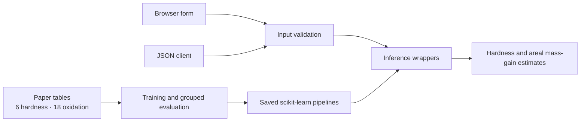

# Material Hardness & Oxidation Prediction

<p align="center">
  <strong>A paper-grounded machine-learning demonstration for Stellite-6 TIG hardfacing</strong>
</p>

<p align="center">
  <a href="https://github.com/TheComputationalCore/Material-Hardness-Oxidation-Prediction/actions/workflows/ci.yml"></a>
  
  
  
  <a href="LICENSE"></a>
</p>

> **Research scope:** This project reproduces and explores the measurements in one published experiment. It is not an independently validated engineering predictor. The paper reports only six hardness values and eighteen oxidation values, with no replicate-level measurements or uncertainty estimates.

## Live application

Try the [Stellite-6 Hardfacing Property Predictor](https://material-hardness-oxidation-prediction.onrender.com/). Select a paper-tested substrate, welding current, and oxidation exposure time to view the model estimates.

The free Render service can spin down while idle, so the first request after inactivity may take longer to load.

## What this project does

The application uses the reported results from Chandra et al. (2020) to demonstrate a traceable machine-learning workflow for two targets:

| Target | Reported data | Model inputs | Model |
|---|---:|---|---|
| Hardness | 6 values | Substrate, welding current | Linear regression |
| Oxidation | 18 values | Substrate, welding current, exposure hours | Random forest regression |

The browser interface returns both outputs. The JSON API also returns both outputs and rejects inputs outside the conditions represented in the paper.

## Scientific source

The source experiment is:

> C. Dinesh Chandra, B. Rushikesh, Mohammed Numan, and B. Venkatesh, “Experimental Studies of Stellite-6 Hardfaced Layer on Ferrous Materials by TIG Surfacing Process,” *IOP Conference Series: Materials Science and Engineering*, vol. 998 (2020), 012061. [https://doi.org/10.1088/1757-899X/998/1/012061](https://doi.org/10.1088/1757-899X/998/1/012061)

The experiment deposited Stellite-6 onto EN-8 and mild-steel substrates by TIG surfacing. Welding current, travel speed, and heat input changed together in the reported schedule; the dataset therefore cannot isolate a causal effect of current alone.

### Paper-tested conditions

| Input | Supported values | Notes |
|---|---|---|
| Substrate | EN-8; Mild Steel | Two substrates reported in the paper |
| Welding current | 120, 140, 160 A | Corresponding heat inputs are 0.800, 0.864, 0.912 kJ/mm; travel speeds also change with the schedule |
| Oxidation exposure | 5, 10, 15 hours | Oxidation test temperature is 973 K (700 °C) |

Hardness is reported as a Vickers hardness number, but the paper does not state the test load alongside the tabulated values. The oxidation target is the paper’s reported mass change divided by exposed area, in g/mm². It is cumulative areal mass gain, **not** a time-normalized rate.

The paper appears to print the oxidation mass-change subtraction in reverse order (pre-test weight minus post-test weight). The dataset preserves the values as reported and documents the sign issue; it does not guess a correction without the original lab records. See [data/README.md](data/README.md) for row-level provenance and units.

## Dataset and provenance

The checked-in training datasets contain only the table values reported in the paper:

- [`data/hardness.csv`](data/hardness.csv): 6 rows from Tables 5 and 6 (2 substrates × 3 currents).
- [`data/oxidation.csv`](data/oxidation.csv): 18 rows from Tables 8–13 (2 substrates × 3 currents × 3 exposure times).
- [`data/README.md`](data/README.md): source tables, units, scope, and data-status policy.

Every training row is marked `reported_paper_measurement`. Training scripts reject rows with a different status. Interpolated values are not independent experiments and are not included as training measurements. The paper does not provide specimen-level replicates or measurement uncertainty.

## Models and evaluation

### Pipelines

Both models use a scikit-learn preprocessing pipeline. Substrate is one-hot encoded; numeric inputs are standardized.

- **Hardness:** linear regression on substrate and current.
- **Oxidation:** a 300-tree random forest on substrate, current, and exposure hours (`random_state=42`).

### Grouped validation results

Validation uses **Leave-One-Group-Out**, with welding current as the group. Each fold holds out all observations at one current, including both substrates and, for oxidation, all three exposure times. After validation, the saved deployment pipeline is refit on all reported paper rows.

| Target | MAE | RMSE | R² |
|---|---:|---:|---:|
| Hardness number | 26.25 | 27.51 | -0.656 |
| Areal mass gain (g/mm²) | 0.000440 | 0.000512 | 0.937 |

There are only **three current groups**. Two folds require predicting beyond the current range in that fold’s training data. The negative hardness R² indicates that the current hardness model generalizes poorly when a whole current level is withheld. The oxidation score is encouraging as a small-data diagnostic, but it is still based on only three groups and does not establish performance on new specimens.

The reported cross-validation metrics are not the same as testing the final saved pipeline on an independent experiment: the deployable model is trained on all six or eighteen reported rows. Predictions at the paper’s conditions should therefore be treated as model estimates, not independent validation results.

### Why older scores may differ

An earlier project version included interpolated/derived rows and evaluated a random row split. Nearby values from the same experimental trend could then appear in both training and test sets, producing an optimistic score. The current workflow retains only measurements reported in the paper and holds out entire current groups. The two scores answer different questions and should not be compared as if they were the same evaluation.

## Application and API

### Browser interface

The interface provides selectors for substrate, current, and exposure time; displays hardness and cumulative areal mass-gain estimates; and reports the paper-tested schedule for heat input and travel speed. Inputs are restricted to values represented in the experiment.

### Screenshots and figures

The repository retains screenshots and plots from earlier versions of the project as part of its development history. **They are archival material, not screenshots or results from the current paper-aligned application.** In particular, the old interface screenshots show inputs that are no longer accepted, and the old model plots use features and data that are not part of the current six-row hardness and eighteen-row oxidation training datasets. Do not use those images to describe the current API, features, model performance, or scientific conclusions.

The live application link above shows the current interface. Expand the sections below to view the archived visuals and their context.

<details>
<summary>Archived application screenshots</summary>

These captures document the former UI, which included heat input, soaking time, carbon, and manganese inputs. Those fields were removed because they are not independent predictors supported by the paper-aligned model.

| Former prediction form | Former prediction result |
|---|---|
|  |  |

</details>

<details>
<summary>Archived SHAP plots</summary>

These plots are retained for historical completeness only. Their generic “Feature 0” labels do not identify the current model inputs, and SHAP is not part of the current application or validated workflow.


The same two plots are also preserved as the former app's static assets: [`shap_hardness_bar.png`](src/app/static/shap_hardness_bar.png) and [`shap_oxidation_bar.png`](src/app/static/shap_oxidation_bar.png).

</details>

<details>
<summary>Archived exploratory and model-diagnostic charts</summary>

The charts below were generated for the earlier expanded dataset and earlier feature set. They are not the Leave-One-Group-Out validation results reported in this README. The old correlations and feature-importance plots include variables excluded from the current models; the actual-versus-predicted and residual plots should not be read as independent test-set performance.

#### Earlier exploratory analysis

| Hardness correlation | Hardness distributions |
|---|---|
|  |  |

| Oxidation correlation | Oxidation distributions |
|---|---|
|  |  |

#### Earlier model diagnostics

| Hardness coefficients | Oxidation feature importance |
|---|---|
|  |  |

| Hardness actual vs predicted | Hardness residuals |
|---|---|
|  |  |

| Oxidation actual vs predicted | Oxidation residuals |
|---|---|
|  |  |

</details>

<details>
<summary>Former concept banner</summary>

This artwork is an early, illustrative project graphic. Its microstructure imagery and embedded chart labels are decorative and are not experimental data or outputs from the current models.


</details>

### JSON API

`POST /api/v1/predict`

Example request:

```json
{
  "Material": "EN-8",
  "Current": 140,
  "Exposure_Time_h": 10
}
```

Example response:

```json
{
  "hardness": 365.0,
  "hardness_error": null,
  "oxidation_areal_mass_gain_g_mm2": 0.004592,
  "oxidation_error": null,
  "oxidation_target_definition": "cumulative mass gain per exposed area; g/mm^2; not time-normalized"
}
```

Allowed values are `Material`: `EN-8` or `Mild Steel`; `Current`: `120`, `140`, or `160`; and `Exposure_Time_h`: `5`, `10`, or `15`. A non-object JSON body or an unsupported/missing/non-finite input returns HTTP 400. See [docs/API_REFERENCE.md](docs/API_REFERENCE.md) for the full contract.

## Architecture



| Path | Purpose |
|---|---|
| `data/` | Paper-transcribed CSVs and dataset provenance |
| `docs/` | Model card, architecture, and API reference |
| `models/` | Saved model metadata and fitted artifacts generated by training |
| `src/models/` | Feature pipelines, model training, and grouped evaluation |
| `src/inference/` | Artifact loading and paper-condition validation |
| `src/app/` | Flask application, routes, templates, and static assets |
| `tests/` | App and inference checks |
| `.github/workflows/ci.yml` | Training, lint, and test workflow |
| `render.yaml`, `Procfile` | Render and Gunicorn deployment configuration |

More detail: [docs/ARCHITECTURE.md](docs/ARCHITECTURE.md), [docs/MODEL_CARD.md](docs/MODEL_CARD.md), and [docs/API_REFERENCE.md](docs/API_REFERENCE.md).

## Run locally

Use Python 3.10, matching the CI and Render runtime.

```bash
git clone https://github.com/TheComputationalCore/Material-Hardness-Oxidation-Prediction.git
cd Material-Hardness-Oxidation-Prediction

python3.10 -m venv .venv
source .venv/bin/activate
python -m pip install --upgrade pip
pip install -r requirements.txt

python -m src.app.app
```

Open [http://localhost:5001](http://localhost:5001).

## Reproduce training and evaluation

Train each model and regenerate its metadata:

```bash
python -m src.models.train_hardness
python -m src.models.train_oxidation
```

Report grouped evaluation metrics without rewriting the saved artifacts:

```bash
python -m src.models.evaluate
```

Install development dependencies and run the repository checks:

```bash
pip install -r requirements-dev.txt
ruff check .
pytest -q
```

The GitHub Actions workflow trains both models, runs Ruff, and runs the tests on pull requests to `main` and pushes to `main`.

## Deployment

The service is deployed on Render from the `main` branch. Configuration is in [`render.yaml`](render.yaml); the start command uses Gunicorn with the Flask application factory. The service uses Python 3.10.13 and installs dependencies from `requirements.txt`.

## Responsible interpretation

- Use this project to reproduce the reported paper table and demonstrate a small ML workflow.
- Do not interpret the models as validated on independent specimens; no such validation data are available in the paper.
- Do not use the outputs for production control, safety decisions, or process optimization.
- Do not infer that current alone causes a hardness or oxidation change; current, travel speed, and heat input vary together.
- Do not apply the models to other substrates, processes, temperatures, or settings.
- New experimental records should retain specimen-level measurements, provenance, units, test conditions, and a distinct data-status label. Do not relabel interpolated values as measurements.

## Citation

If you use this project, cite the experimental paper that provides its training data:

```text
Chandra, C. D., Rushikesh, B., Numan, M., & Venkatesh, B. (2020).
Experimental Studies of Stellite-6 Hardfaced Layer on Ferrous Materials
by TIG Surfacing Process. IOP Conference Series: Materials Science and
Engineering, 998, 012061.
https://doi.org/10.1088/1757-899X/998/1/012061
```

## License

This project is distributed under the [MIT License](LICENSE).
