# Material Hardness & Oxidation Prediction

<p align="center">
  <strong>A paper-grounded machine-learning demonstration for Stellite-6 TIG hardfacing</strong>
</p>

<p align="center">
  <a href="https://github.com/TheComputationalCore/Material-Hardness-Oxidation-Prediction/actions/workflows/ci.yml"></a>
  
  
  
  <a href="LICENSE"></a>
  <a href="data/LICENSE"></a>
</p>

> **Research scope:** This project reproduces and explores the measurements in one
> published experiment. It is not an independently validated engineering predictor.
> The paper reports six hardness values and eighteen oxidation values with no
> replicate specimens or uncertainty estimates. The eighteen oxidation rows reduce
> to six effective Material × Current conditions.

## Live application

Try the [Stellite-6 Hardfacing Property Predictor](https://material-hardness-oxidation-prediction.onrender.com/).
Select a paper-tested substrate, welding current, and exposure time to see the
model estimate, an approximate interval, and the value printed in the paper.

The free Render service can spin down while idle, so the first request after
inactivity may take longer.

## What this project does

The application demonstrates a traceable small-data workflow using the reported
results from Chandra et al. (2020):

| Target | Reported data | Effective conditions | Inputs | Model |
|---|---:|---:|---|---|
| Hardness | 6 values | 6 | Substrate, current | Linear regression (v0.2.0) |
| Oxidation | 18 values | 6 | Substrate, current, exposure hours | Linear mass-gain **rate** model (v0.3.0) |

The browser returns both estimates. The JSON API returns both estimates plus the
applicability domain, approximate 90 % intervals, model versions, warnings, and
the paper-reported value at that condition.

## Scientific source

> C. Dinesh Chandra, B. Rushikesh, Mohammed Numan, and B. Venkatesh,
> “Experimental Studies of Stellite-6 Hardfaced Layer on Ferrous Materials by TIG
> Surfacing Process,” *IOP Conference Series: Materials Science and Engineering*,
> vol. 998 (2020), 012061.
> [https://doi.org/10.1088/1757-899X/998/1/012061](https://doi.org/10.1088/1757-899X/998/1/012061)

The experiment deposited Stellite-6 onto EN-8 and mild-steel substrates by TIG
surfacing. Welding current, travel speed, and heat input changed together in the
reported schedule; the dataset cannot isolate a causal effect of current alone.

### Paper-tested conditions

| Input | Supported values | Notes |
|---|---|---|
| Substrate | `EN-8`; `Mild Steel` | Two substrates reported in the paper |
| Welding current | `120`, `140`, `160` A | Heat inputs 0.800, 0.864, 0.912 kJ/mm; travel speed also changes |
| Oxidation exposure | `5`, `10`, `15` hours | 973 K (700 °C) |

The paper gives no replicate-level data or uncertainty estimates. It does not
state the Vickers test load. The oxidation target is the paper's printed mass
change divided by area; it is cumulative, not time-normalized.

## What the source audit found

The audit is a CI gate and is documented in
[`docs/SOURCE_AUDIT.md`](docs/SOURCE_AUDIT.md), with generated output in
[`reports/audit/`](reports/audit/).

| Check | Result |
|---|---|
| Table transcription | 24 / 24 values and labels match the paper |
| Process arithmetic | `Q = 15 V · I / v` reproduces 0.800 / 0.864 / 0.912 kJ/mm within rounding |
| Exposure-time multiples | 11 exact and 1 near multiple (0.08 % deviation); effective oxidation n = 6 |
| Specimen dimensions | **Unresolved**: methods say 30 × 30 mm², Table 7 says 15 × 15 mm (225 mm²) |
| Oxidation unit | **Unresolved**: literal g/mm² implies an implausible 0.487–1.817 g specimen change; raw grams at 225 mm² would give 0.96–3.59 mg/cm² |
| Oxidation sign | **Unresolved**: printed `w1 − w2` implies mass loss, but every value is positive |
| Replicates | None reported for any condition |

These are not corrected by assumption. They appear in the data columns, API
warnings, UI, manifests, model card, and benchmark notes.

## Dataset and provenance

| File | Content |
|---|---|
| [`data/hardness.csv`](data/hardness.csv) | 6 rows from Tables 5 and 6 (2 substrates × 3 currents) |
| [`data/oxidation.csv`](data/oxidation.csv) | 18 rows from Tables 8–13 (2 substrates × 3 currents × 3 exposures) |
| [`data/source_tables.json`](data/source_tables.json) | Transcribed source values, equations, units, and PDF digests (Tables 1–13) |
| [`data/README.md`](data/README.md) | Column meanings, units, scope, and unresolved issues |
| [`data/external/`](data/external/README.md) | Header-only templates and validator for new measurements, kept separate from training |

Every training row is marked `reported_paper_measurement`. The loader rejects any
other `Data_Status`, and new measurements go through the external path instead:
raw hardness readings or raw oxidation weights are validated, scored against the
shipped models, and never merged into training automatically. Interpolated values
are not independent experiments and are not training measurements. See
[`docs/EXPERIMENTAL_PLAN.md`](docs/EXPERIMENTAL_PLAN.md) for how to collect them.

## Models and evaluation

### Pipelines

- **Hardness:** one-hot substrate + standardized current → linear regression.
- **Oxidation:** linear rate model. It fits areal gain per hour from substrate and
  current, then multiplies by exposure:

  ```text
  rate = a + b · current + c · substrate
  areal mass gain = rate × exposure_hours
  ```

  This matches the table's near-exact linear-time structure and works with six
  effective conditions. The previous 300-tree random forest could not extrapolate
  and was outperformed under identical folds.

### Grouped validation

Primary protocol: **Leave-One-Current-Out** (LOCO) over three current groups. All
rows at one current, including both substrates and all exposure times, are held
out. Two of the three folds require predicting outside the training current
range. Secondary protocol: **Leave-One-Condition-Out** (LOGO) over six
Material × Current cells.

| Target | Protocol | MAE | RMSE | R² | Fold MAE (mean ± sd) |
|---|---|---:|---:|---:|---:|
| Hardness | LOCO | 26.25 | 27.51 | −0.656 | 26.25 ± 7.42 |
| Oxidation | LOCO | 1.346 × 10⁻⁴ | 1.631 × 10⁻⁴ | 0.9936 | 1.35 × 10⁻⁴ ± 0.48 × 10⁻⁴ |

The negative hardness R² means withholding an entire current is worse than
predicting the mean. The oxidation score is encouraging but rests on six
effective conditions, not eighteen independent samples. The deployable pipelines
are refit on all reported rows after validation, so these metrics describe
transfer to an unseen current, not accuracy on the training table.

### Fair comparison and model change

Every baseline and challenger was run under the same folds. The adoption rule was
fixed before looking at results:

1. primary LOCO MAE improves by at least 20 %;
2. at least two of three folds improve;
3. secondary LOGO MAE does not worsen by more than 10 %.

| Target | Shipped | Best challenger | Δ LOCO MAE | Folds improved | Decision |
|---|---|---|---:|---:|---|
| Hardness | `linear` | `ridge` | −12.0 % | 1 / 3 | Keep `linear` |
| Oxidation | `random_forest` (v0.2.0) | `rate_linear` | −69.4 % | 3 / 3 | Adopt `rate_linear` |

The oxidation adoption is recorded in
[`reports/benchmark/pre_adoption_random_forest/`](reports/benchmark/pre_adoption_random_forest/)
and in the reproducibility baseline. The hardness challenger did not meet the
evidence bar, so the simpler model remains.

Full outputs: [`reports/benchmark/`](reports/benchmark/), including out-of-fold
predictions, fold metrics, selection rationale, and single-row sensitivity.

### Uncertainty and applicability

Every response includes an approximate 90 % interval from signed LOCO residual
quantiles (`models/calibration.json`):

| Target | n OOF | Effective n | Lower offset | Upper offset |
|---|---:|---:|---:|---:|
| Hardness | 6 | 6 | −17.50 | +36.50 |
| Oxidation | 18 | 6 | −3.465 × 10⁻⁴ | +2.61 × 10⁻⁴ |

These are not guaranteed-coverage intervals. They summarize observed errors in a
handful of conditions and cannot represent specimen-to-specimen variability that
was never measured.

Every response also states whether the condition is a `reported_condition`, an
`unmeasured_combination_within_tested_levels`, or `outside_tested_conditions`.
When the exact condition is in the paper, the printed value and source table are
returned alongside the estimate for comparison.

## Application and API

### Browser interface

The interface provides selectors for substrate, current, and exposure; displays
hardness and cumulative areal mass-gain estimates with intervals, applicability,
and warnings; and includes a model-details panel populated from
`/api/v1/model-info`.

### JSON API

`POST /api/v1/predict`

```json
{
  "Material": "EN-8",
  "Current": 140,
  "Exposure_Time_h": 10
}
```

Response (abridged):

```json
{
  "ok": true,
  "hardness": 355.6666666666667,
  "hardness_interval_90": {"lower": 338.1666666666667, "upper": 392.1666666666667},
  "hardness_applicability": {
    "status": "reported_condition",
    "measured_value": 365.0,
    "measured_source_table": "Table 6"
  },
  "oxidation_areal_mass_gain_g_mm2": 0.004708,
  "oxidation_interval_90": {"lower": 0.0043615, "upper": 0.004969},
  "oxidation_applicability": {
    "status": "reported_condition",
    "measured_value": 0.004592,
    "measured_source_table": "Table 11"
  },
  "oxidation_target_definition": "Cumulative mass gain per exposed area; g/mm^2 as printed; not time-normalized.",
  "model_versions": {"hardness": "0.2.0", "oxidation": "0.3.0"},
  "warnings": ["..."]
}
```

Allowed values are `Material`: `EN-8` or `Mild Steel`; `Current`: `120`, `140`,
or `160`; `Exposure_Time_h`: `5`, `10`, or `15`. A non-object body or an
unsupported/missing/non-finite input returns HTTP 400; a missing artifact returns
HTTP 503. See [`docs/API_REFERENCE.md`](docs/API_REFERENCE.md) for the full
contract, `/api/v1/model-info`, and `/healthz`.

## Architecture

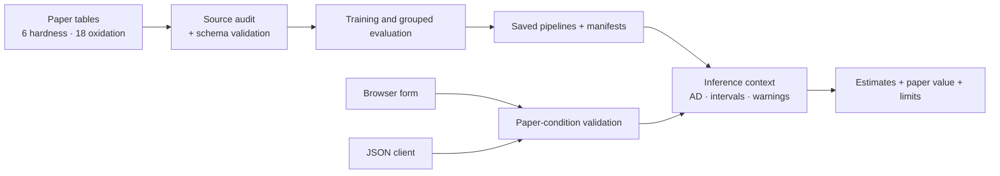

| Path | Purpose |
|---|---|
| `data/` | Paper-transcribed CSVs, source tables, provenance, and data license |
| `docs/` | Model card, architecture, API reference, source audit, experimental plan, reproducibility |
| `models/` | Fitted artifacts, metadata, manifests, and calibration |
| `reports/` | Audit, benchmark, and reproducibility outputs |
| `src/data/` | Schema validation and source-table audit |
| `src/models/` | Pipelines, training, evaluation, manifests, calibration, benchmark |
| `src/inference/` | Artifact loading, validation, applicability domain, intervals |
| `src/app/` | Flask routes, templates, and static assets |
| `tests/` | Schema, audit, manifest, benchmark, domain, API, and app tests |
| `.github/workflows/ci.yml` | Audit, training, calibration, reproducibility, benchmark, lint, tests |
| `render.yaml`, `Procfile` | Render and Gunicorn deployment configuration |

More detail: [`docs/ARCHITECTURE.md`](docs/ARCHITECTURE.md) and
[`docs/MODEL_CARD.md`](docs/MODEL_CARD.md).

## Run locally

Use Python 3.10, matching CI and Render.

```bash
git clone https://github.com/TheComputationalCore/Material-Hardness-Oxidation-Prediction.git
cd Material-Hardness-Oxidation-Prediction

python3.10 -m venv .venv
source .venv/bin/activate
python -m pip install --upgrade pip
pip install -r requirements.txt -r requirements-dev.txt

python -m src.app.app
```

Open [http://localhost:5001](http://localhost:5001).

## Reproduce training and evaluation

```bash
python -m src.data.audit            # source tables, arithmetic, multiples
python -m src.models.train_hardness # writes model, metadata, manifest
python -m src.models.train_oxidation
python -m src.models.calibration    # intervals from OOF residuals
python -m src.models.reproducibility --write
python -m src.models.benchmark      # baselines, challengers, sensitivity
python -m src.models.external_validation --write  # score external measurements

ruff check .
ruff format --check .
pytest -q
```

Or use `make audit`, `make train`, `make calibrate`, `make reproduce`,
`make benchmark`, `make external`, `make test`, and `make lint`. The
reproducibility baseline and update procedure are documented in
[`docs/REPRODUCIBILITY.md`](docs/REPRODUCIBILITY.md).

## CI and deployment

GitHub Actions runs on pushes and pull requests to `main`: audit, train both
models, regenerate calibration, verify the reproducibility baseline, run the
benchmark, validate the external measurement files, run Ruff check and format
check, and run the tests. A data or model change that does not update the baseline
and benchmark fails CI.

The service is deployed on Render from `main`; see [`render.yaml`](render.yaml).
The runtime is Python 3.10.13, and the Gunicorn start command uses the Flask
application factory. `/healthz` reports artifact availability.

## Archived material

The repository retains screenshots, SHAP plots, exploratory charts, and a
decorative banner from earlier versions. **They are archival, not current
results.** The old interface accepted heat input, soaking time, carbon, and
manganese; those fields were removed because the paper does not support them as
independent predictors. The old model plots use an expanded dataset and feature
set that are no longer part of training.

<details>
<summary>Archived application screenshots</summary>

| Former prediction form | Former prediction result |
|---|---|
|  |  |

</details>

<details>
<summary>Archived SHAP plots</summary>

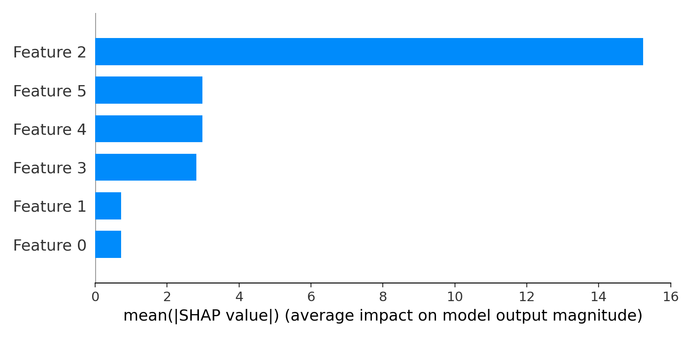

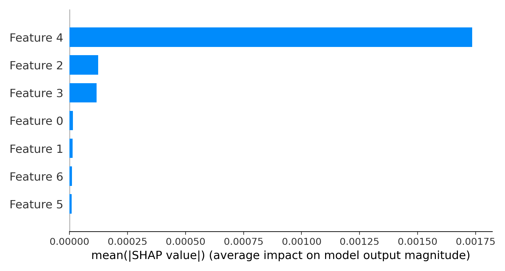

SHAP is not part of the current application or validated workflow. With
collinear process factors and six conditions, per-prediction attributions would
look authoritative without being identified.

</details>

<details>
<summary>Archived exploratory and model-diagnostic charts</summary>

These were generated for the earlier expanded dataset and are not the current
Leave-One-Current-Out results.

| Hardness correlation | Hardness distributions |
|---|---|
| 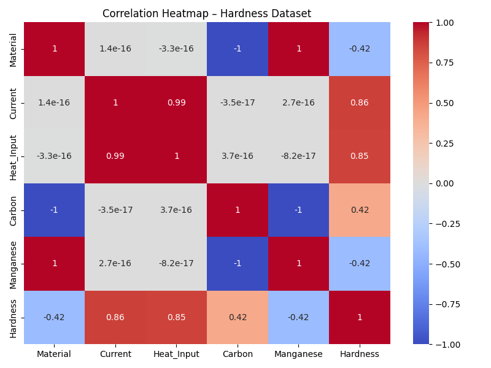 | 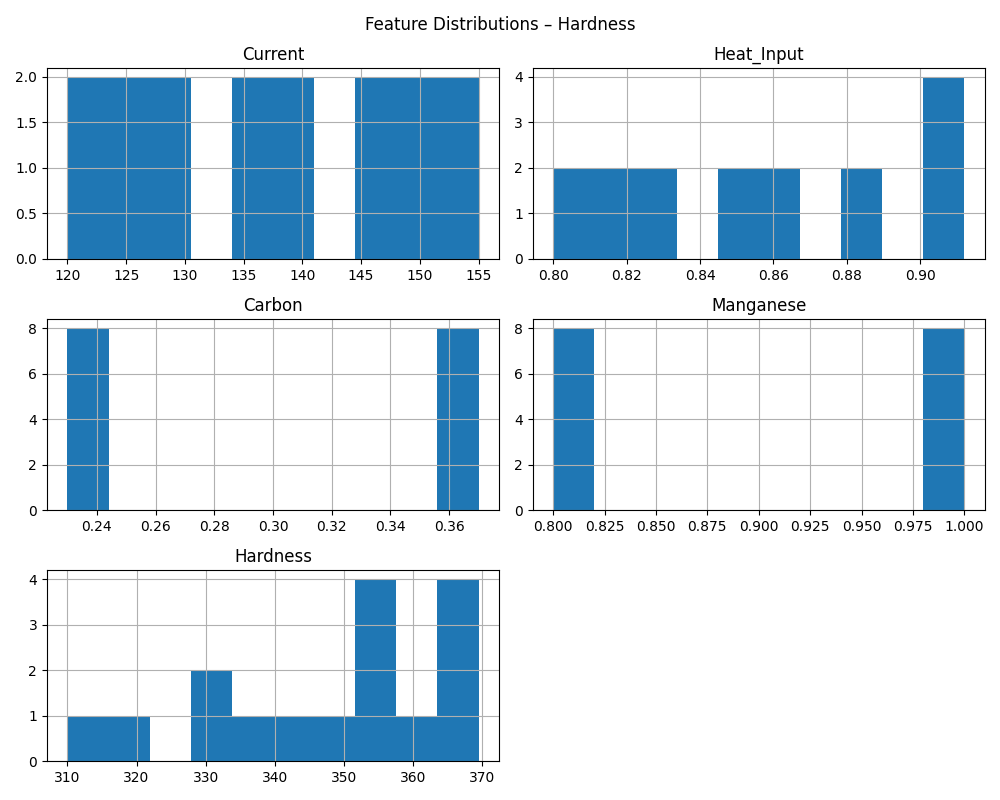 |

| Oxidation correlation | Oxidation distributions |
|---|---|
| 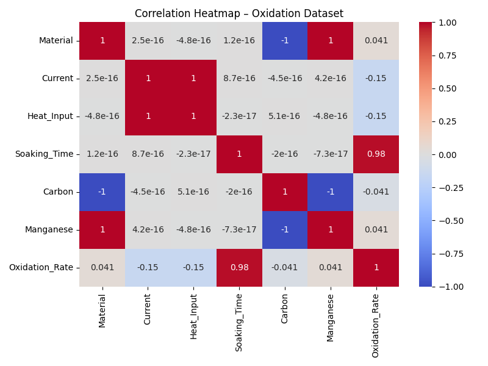 | 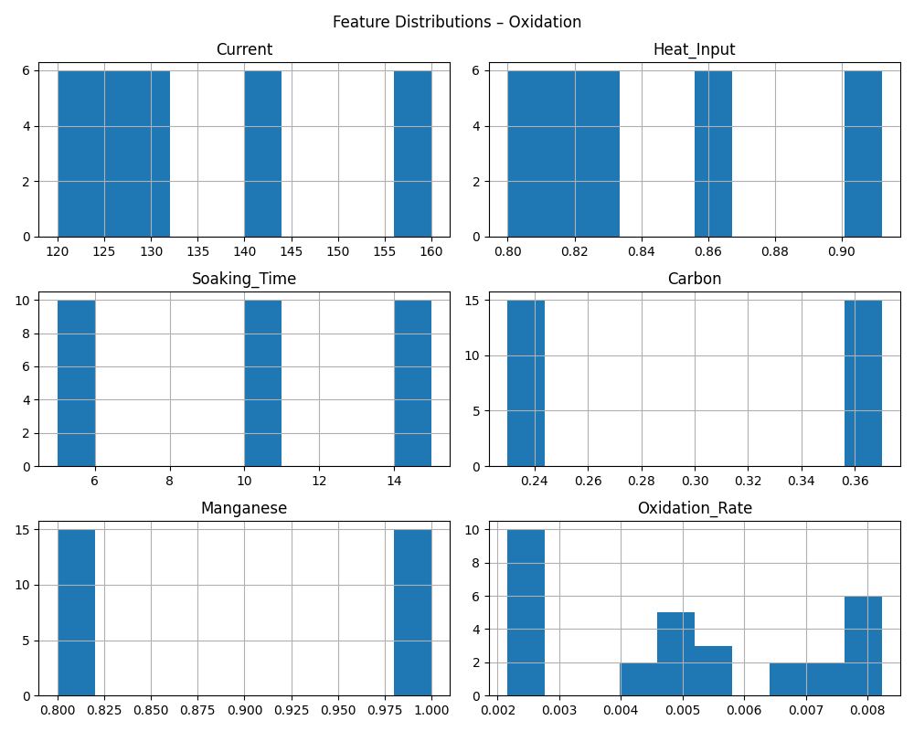 |

| Hardness coefficients | Oxidation feature importance |
|---|---|
| 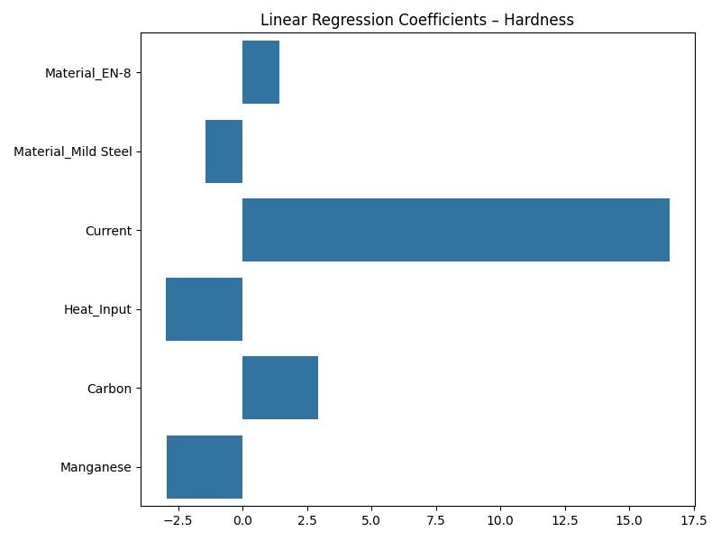 | 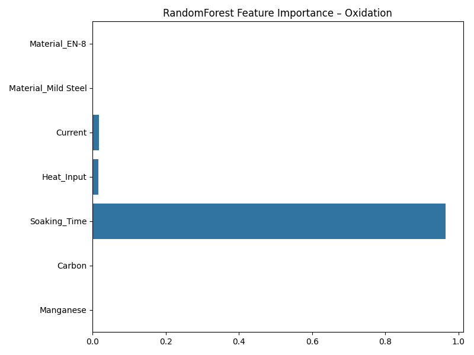 |

| Hardness actual vs predicted | Hardness residuals |
|---|---|
| 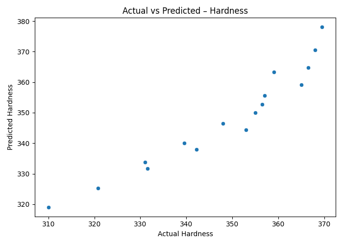 | 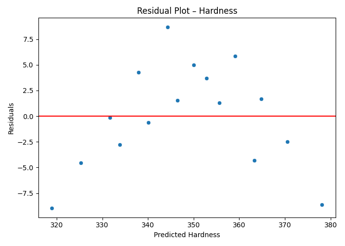 |

| Oxidation actual vs predicted | Oxidation residuals |
|---|---|
| 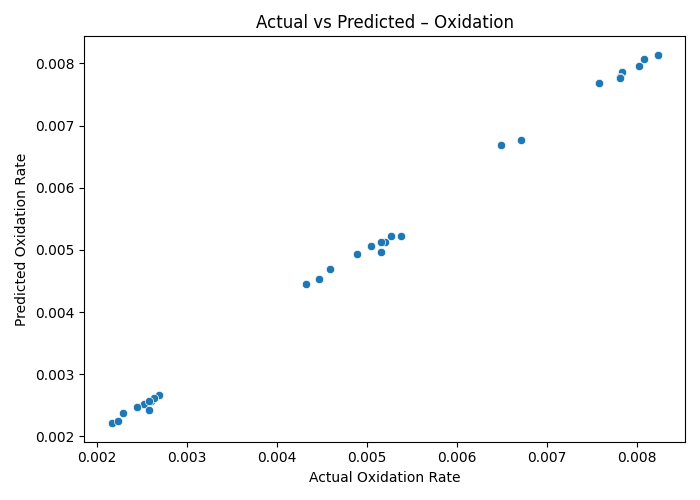 | 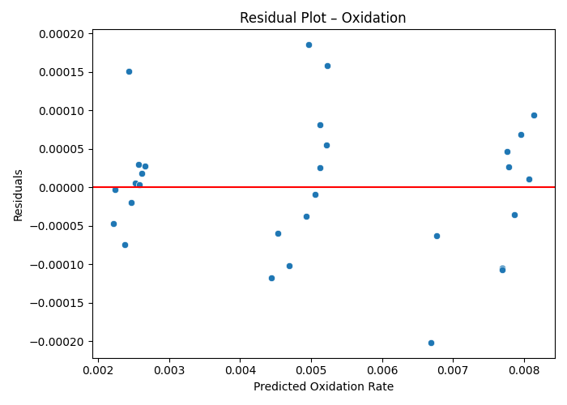 |

</details>

<details>
<summary>Former concept banner</summary>


Decorative only; not experimental data or a current model output.

</details>

## Responsible interpretation

- Use this project to reproduce the paper's table and demonstrate a small,
  traceable ML workflow.
- Do not treat the models as validated on independent specimens; no such data are
  available in the paper.
- Do not use the outputs for production control, safety decisions, or process
  optimization.
- Do not infer that current alone causes a hardness or oxidation change; current,
  travel speed, and heat input vary together.
- Do not apply the models to other substrates, processes, temperatures, currents,
  exposures, or specimen preparations.
- Do not interpret the printed oxidation magnitude as a physical mass change
  without resolving the unit and sign.
- New experiments should record specimen-level measurements, provenance, units,
  test conditions, and a distinct data status. See
  [`docs/EXPERIMENTAL_PLAN.md`](docs/EXPERIMENTAL_PLAN.md).

## Citation and license

If you use this project, cite the experimental paper that provides its training
data:

```text
Chandra, C. D., Rushikesh, B., Numan, M., & Venkatesh, B. (2020).
Experimental Studies of Stellite-6 Hardfaced Layer on Ferrous Materials
by TIG Surfacing Process. IOP Conference Series: Materials Science and
Engineering, 998, 012061.
https://doi.org/10.1088/1757-899X/998/1/012061
```

Software citation metadata is in [`CITATION.cff`](CITATION.cff).

- Code: [MIT License](LICENSE).
- Transcribed paper data: [CC BY 3.0](data/LICENSE), with attribution to the
  original authors.
- Contributions: see [`CONTRIBUTING.md`](CONTRIBUTING.md).
