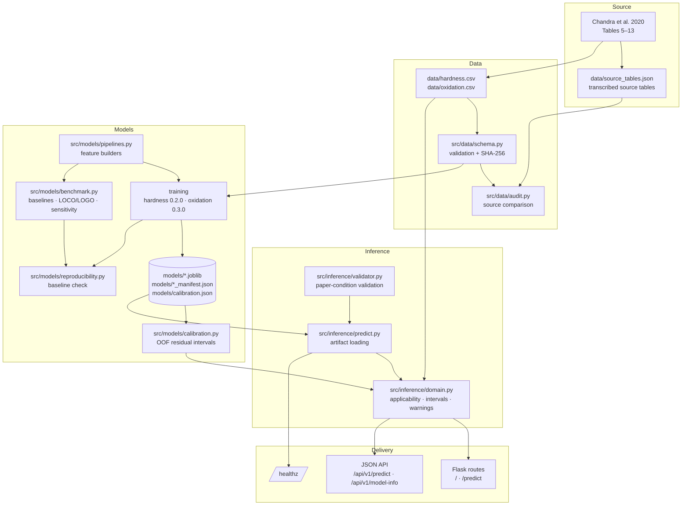

# Architecture

## Overview

The project has four layers: canonical data, model training and evaluation,
inference context, and delivery (browser and JSON API). Every layer consumes the
same checked-in CSVs and the same feature builders.



## Module responsibilities

| Path | Responsibility |
|---|---|
| `src/data/schema.py` | Canonical column set, row counts, allowed materials/currents/exposures/statuses, target bounds, heat-input consistency, duplicate-key checks, dataset hashing, measured-value lookup. |
| `src/data/audit.py` | Compares CSVs with `data/source_tables.json`, checks `Q = 15 V · I / v`, classifies exposure-time multiples, and writes `reports/audit/`. |
| `src/data/external.py` | Validates new-measurement files in `data/external/`, rejects paper rows, derives physical mass change and areal gain from raw weights, and keeps `Paper_Unit_Value` optional. |
| `src/models/pipelines.py` | Canonical feature lists, preprocessing, hardness linear pipeline, oxidation rate pipeline, and the legacy random-forest builder used as a benchmark challenger. |
| `src/models/estimators.py` | `GroupMeanRegressor`, `RateMeanRegressor`, and `RateLinearRegressor`. |
| `src/models/train_hardness.py` | Validates data, runs LOCO evaluation, fits the deployment pipeline on all rows, writes the artifact, metadata, and manifest. |
| `src/models/train_oxidation.py` | Same workflow for the oxidation rate model, with effective-n and independence notes. |
| `src/models/manifest.py` | Manifest schema, artifact/data hashing, git and environment capture, verification. |
| `src/models/reproducibility.py` | Recomputes LOCO metrics and compares them with `reports/reproducibility/expected_metrics.json`. |
| `src/models/benchmark.py` | Runs every baseline and challenger under identical folds, writes OOF predictions, fold metrics, selection, and sensitivity. |
| `src/models/calibration.py` | Computes OOF residual quantiles and writes `models/calibration.json`. |
| `src/models/external_validation.py` | Scores validated external rows against the shipped models, writes per-row and by-condition results, and refuses to compute oxidation residuals without a comparable paper-unit value. |
| `src/models/evaluate.py` | Prints grouped evaluation metrics without rewriting artifacts. |
| `src/inference/validator.py` | Rejects missing, non-numeric, non-finite, or untested inputs. |
| `src/inference/predict.py` | Loads artifacts lazily, predicts both targets, attaches applicability and intervals. |
| `src/inference/domain.py` | Describes the applicability domain, returns the printed paper value when the condition matches, builds 90 % intervals, and exposes model-card metadata. |
| `src/app/routes.py` | Page, form submission, JSON API, model-info, and health endpoints. |
| `src/app/templates/index.html` | Server-rendered form and results; includes a model-details panel populated from `/api/v1/model-info`. |
| `src/app/static/app.js` | Theme, async form submission, safe DOM rendering, result copy/reset, and error display. |
| `src/app/static/style.css` | Layout, light/dark theme, result badges, warnings, and model-info styling. |

## Data flow

1. **Ingest.** Training reads `data/hardness.csv` or `data/oxidation.csv` through
   `load_dataset`, which validates every row before it reaches a model.
2. **Validate.** The loader checks expected row counts, allowed levels, target
   bounds, duplicate keys, provenance labels, and heat-input consistency with
   Table 1. It raises one aggregate error listing every violation.
3. **Evaluate.** `cross_val_predict` with `LeaveOneGroupOut(groups=Current)`
   produces six hardness or eighteen oxidation out-of-fold predictions.
4. **Fit.** The deployment pipeline is refit on all reported rows. Metrics in the
   manifest are the **validation** metrics, not training residuals.
5. **Record.** The artifact, metadata, and manifest are written with hashes and
   environment details.
6. **Calibrate.** The calibration script recomputes the same OOF predictions and
   stores residual quantiles.
7. **Serve.** The Flask layer validates inputs, loads the artifacts, and attaches
   applicability, measured value, interval, warnings, and model version.
8. **Validate externally.** New measurements in `data/external/` pass a separate
   validator, then are scored against the shipped models without retraining.
   Oxidation residuals require `Paper_Unit_Value`; physical areal gains from raw
   weights are reported separately. External rows never enter the training files.
9. **Verify.** CI retrains, recalibrates, checks the baseline, runs the benchmark,
   validates the external files, lints, and tests.

## Models

### Hardness (v0.2.0)

```text
Hardness = β0 + β1·Current + β2·[Material = Mild Steel] + ε
```

Inputs are one-hot `Material` and standardized `Current`, followed by ordinary
least squares. With six rows, six conditions, and a collinear process schedule,
this is the simplest estimable model. It is retained despite a negative LOCO R²
because no challenger met the pre-registered adoption rule.

### Oxidation (v0.3.0)

```text
rate = a + b·Current + c·[Material = Mild Steel]
Areal_Mass_Gain = rate × Exposure_Time_h
```

`RateLinearRegressor` fits on `y / Exposure_Time_h` and multiplies the predicted
rate by the requested exposure. The form follows the table's near-exact linear
time structure and works with six effective Material × Current conditions. It
outperformed the previous 300-tree random forest by 69.4 % in LOCO MAE in 3 of 3
folds; see `reports/benchmark/`.

## Evaluation design

| Protocol | Group held out | What it tests |
|---|---|---|
| `LOCO_current` (primary) | All rows at one current | Transfer to an unseen process setting |
| `LOGO_condition` (secondary) | One Material × Current cell | Interpolation with the other substrate at the same current still in training |

LOGO is not independent for oxidation because the three exposure rows at a
condition remain together and are multiples of one another. Effective n remains
six.

Baselines in the benchmark include global mean/median, substrate mean, current
mean, time mean, and rate mean. Challengers include ridge, random forest, and
linear variants with and without an explicit time term. The adoption rule is in
`src/models/benchmark.py` and is not tuned after seeing results.

## Inference contract

1. `validate_material` accepts only `EN-8` and `Mild Steel`.
2. `validate_current` accepts only `120`, `140`, or `160`.
3. Oxidation exposure accepts only `5`, `10`, or `15`.
4. Any missing, blank, non-numeric, or non-finite value is rejected.
5. A valid condition yields:
   - the estimate,
   - a 90 % approximate interval,
   - an applicability record with `reported_condition`,
     `unmeasured_combination_within_tested_levels`, or
     `outside_tested_conditions`,
   - the printed paper value and source table when the condition matches,
   - model version and warnings.
6. If an artifact is missing or unreadable, the API returns HTTP 503; if the input
   is invalid, HTTP 400.

The public API rejects untested levels before prediction, so
`unmeasured_combination_within_tested_levels` and `outside_tested_conditions` are
currently reachable only through the internal `applicability` function and its
tests. This is intentional: the service does not offer extrapolation or
unmeasured combinations.

## Artifacts and provenance

| Artifact | Purpose |
|---|---|
| `models/hardness_model.joblib` | Fitted hardness pipeline |
| `models/oxidation_model.joblib` | Fitted oxidation rate pipeline |
| `models/*_metadata.json` | Lightweight metrics and feature description |
| `models/*_manifest.json` | Full provenance: hashes, environment, config, metrics, limitations |
| `models/calibration.json` | Residual quantiles used for intervals |
| `reports/reproducibility/` | Reference baseline and observed checks |
| `reports/benchmark/` | OOF predictions, fold metrics, selection, sensitivity |
| `reports/audit/` | Source-table audit and unresolved findings |
| `reports/external_validation/` | Scores for new measurements; never used for training |

Manifests are not regenerated by the app at runtime. Training and CI regenerate
them. `verify_manifest` detects edits to either the artifact or the dataset.

## Delivery

- Flask application factory in `src/app/app.py`.
- Gunicorn on Render, Python 3.10.13, health check `/healthz`.
- Static assets are served by Flask; there is no build step.
- The browser form posts to `/predict` with a normal form submission and uses
  `fetch` to `/api/v1/predict` for the asynchronous path. The server-rendered
  result remains usable without JavaScript.

## Archived material

Earlier screenshots, SHAP plots, exploratory charts, and a decorative banner are
kept under `screenshots/`, `docs/archive/`, and `assets/`. They describe previous
datasets and feature sets. They are not outputs of the current pipeline and are
not referenced by the application.

## Design constraints

- **No fabricated rows.** Only `reported_paper_measurement` rows are accepted by
  the training loader.
- **No silent unit correction.** The oxidation values are served as printed, with
  the unresolved unit and sign surfaced in every response.
- **No causal claims.** Current, travel speed, and heat input are collinear.
- **No leakage.** Validation holds out entire current groups; preprocessing is
  inside the pipeline.
- **No hidden model changes.** A model replacement requires benchmark evidence,
  a manifest update, a baseline update, and a model-card entry.
